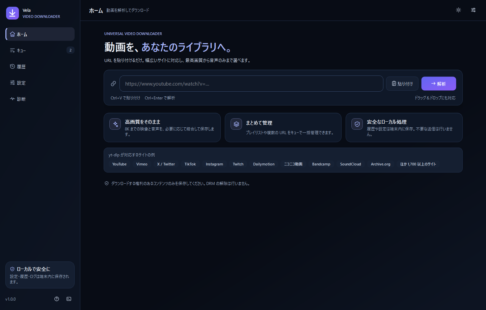
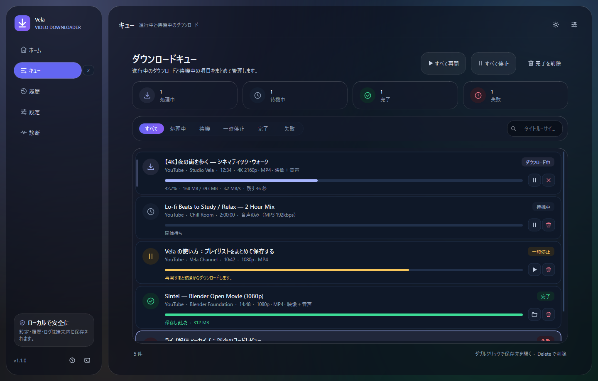
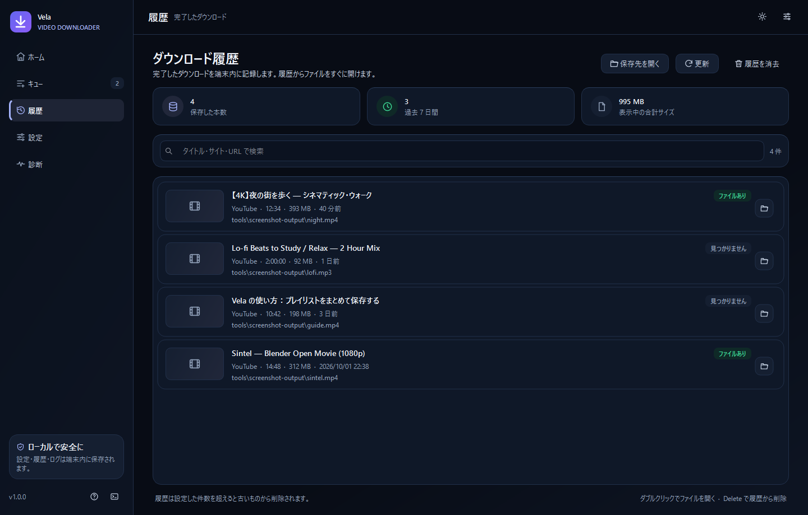
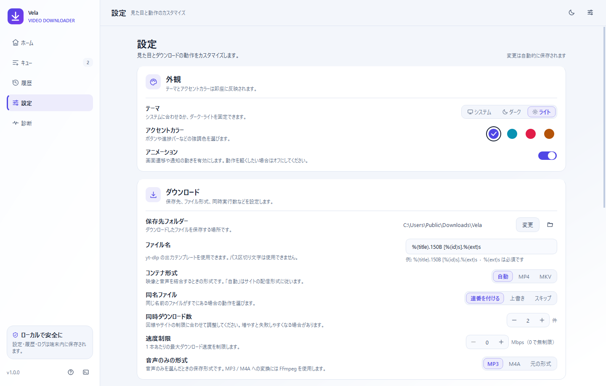
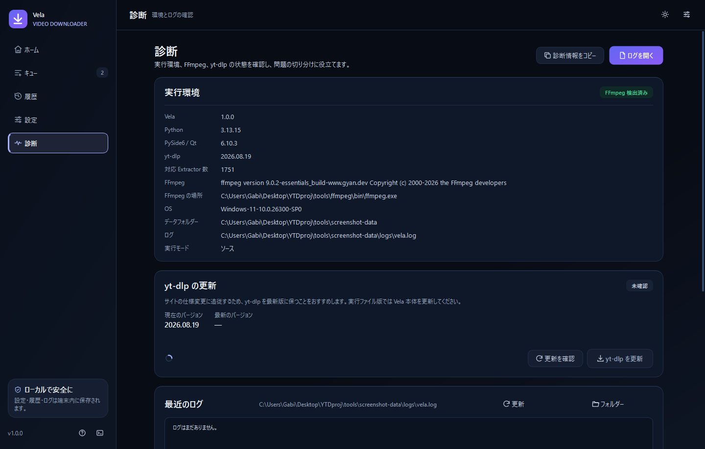

# Vela

**動画を、あなたのライブラリへ。**

Vela は [yt-dlp](https://github.com/yt-dlp/yt-dlp) と FFmpeg を中核にした、日本向けの Windows デスクトップ動画ダウンローダーです。PySide6 で構築したモダンな日本語 UI とダーク／ライトテーマを備え、URL 解析、画質・形式選択、プレイリスト選択、ダウンロードキュー、進捗表示、履歴、設定、診断機能をまとめています。

[GitHub リポジトリ](https://github.com/gabigos/vela) · [MIT License](LICENSE)



## 主な機能

- **URL 解析** — 動画ページの URL を貼り付けるだけで、タイトル・投稿者・再生時間・サムネイル・利用可能な形式を取得します。
- **画質・形式の選択** — 「最高画質（自動）」、MP4、音声のみ（元の形式／MP3／M4A）に加え、個別の映像形式（解像度・コーデック・HDR・推定サイズ付き）をチェックボックスで選択できます。
- **プレイリスト対応** — プレイリストを検出し、任意の動画だけを選んでキューへ追加できます（最大 500 件を解析）。
- **ダウンロードキュー** — 同時ダウンロード数、一時停止／再開、キャンセル、再試行、完了項目の削除に対応します。未完了のキューは終了時に保存され、次回起動時に一時停止状態で復元されます。
- **リアルタイム進捗** — 進捗率、転送量、速度、残り時間、処理フェーズを表示します。UI 更新は間引かれ、大量のキューでも滑らかに動作します。
- **履歴** — 完了したダウンロードを SQLite に記録し、検索・絞り込み・ファイルを開く・元ページを開く・削除ができます。
- **設定** — テーマ（システム／ダーク／ライト）、アクセントカラー 4 色、アニメーション低減、保存先、ファイル名テンプレート、コンテナ、同名ファイルの扱い、同時数、速度制限、音声形式、プロキシ、Cookie、履歴件数、キュー復元、yt-dlp 更新確認、FFmpeg の場所を変更できます。
- **診断** — Python／PySide6／yt-dlp／FFmpeg の状態、データフォルダー、ログの末尾、yt-dlp の更新確認と更新、よくある問題への導線を提供します。
- **安全なローカル処理** — 設定・履歴・キュー・ログ・サムネイルキャッシュはすべて端末内に保存します。DRM の解除、CAPTCHA の回避、認証情報の不正利用は行いません。

## スクリーンショット

| ダウンロードキュー | 履歴 |
| --- | --- |
|  |  |

| 設定（ライト） | 診断 |
| --- | --- |
|  |  |

## 動作環境

- Windows 10 / 11（64-bit）を主対象としています。
- Python 3.11 以上（開発・検証は **Python 3.13.15**）。
- PySide6 6.10 系、yt-dlp 2026.08.19 で動作確認済みです。
- FFmpeg（`ffmpeg.exe` / `ffprobe.exe`）はリポジトリに含めていません。下記の手順で `tools/ffmpeg/bin/` に配置してください。映像と音声の結合、MP3／M4A への変換に使用します。

macOS / Linux でもソースから起動できる可能性がありますが、本バージョンでは検証していません。

## セットアップ

```powershell
git clone https://github.com/gabigos/vela.git
cd vela

# 仮想環境の作成（初回のみ）
python -m venv .venv
.\.venv\Scripts\python.exe -m pip install --upgrade pip
.\.venv\Scripts\python.exe -m pip install -r requirements-dev.txt
```

`requirements-dev.txt` には実行時依存（PySide6 / yt-dlp）に加えて、テスト（pytest / pytest-qt）、静的チェック（ruff）、アイコン生成（Pillow）、Windows 実行ファイル作成（PyInstaller）が含まれます。実行だけなら `requirements.txt` で十分です。

### FFmpeg について

`tools/ffmpeg/bin/ffmpeg.exe` と `ffprobe.exe` が存在すれば、追加設定なしで自動検出されます。別の FFmpeg を使う場合は、設定画面の「FFmpeg」でフォルダーを指定するか、環境変数 `VELA_FFMPEG_DIR` を設定してください。

リポジトリには FFmpeg のバイナリを含めていません。[gyan.dev](https://www.gyan.dev/ffmpeg/builds/) の essentials ビルドを展開し、`bin` フォルダーの中身を `tools/ffmpeg/bin/` に置いてください。`tools/ffmpeg/FFMPEG-README.txt` と `LICENSE` はビルド情報とライセンスの記録です。

## 起動

```powershell
# 推奨: コンソールを出さずに起動
.\run.bat

# 直接起動（ログをコンソールでも確認したい場合）
.\.venv\Scripts\python.exe main.py
```

### コマンドラインオプション

| オプション | 説明 |
| --- | --- |
| `--version` | バージョンを表示して終了します。 |
| `--smoke-test` | 5 ページを構築・遷移する起動確認を行い、結果を終了コードで返します。 |
| `--data-dir PATH` | 設定・履歴・キューの保存先を一時的に変更します（開発・ポータブル用途）。 |
| `--debug` | デバッグレベルのログを出力します。 |

例:

```powershell
.\.venv\Scripts\python.exe main.py --smoke-test --data-dir .\tools\smoke-data
.\.venv\Scripts\python.exe main.py --debug
```

## 使い方

1. **URL を入力** — ホーム画面の入力欄に動画ページの URL を貼り付け、「解析」を押します（`Ctrl+V` で貼り付け、`Ctrl+Enter` でも解析できます）。
2. **形式を選ぶ** — 解析結果から画質・形式を選択します。音声のみを選ぶと MP3／M4A へ変換できます。
3. **プレイリストを選ぶ** — プレイリストの場合は一覧から保存したい動画を選択します。
4. **ダウンロード** — 「キューに追加」で開始します。進捗はキュー画面で確認できます。
5. **キュー操作** — 行のボタンまたは右クリックメニューから一時停止・再開・再試行・キャンセル・削除ができます。`Space` で選択項目の一時停止／再開、`Delete` で削除します。
6. **履歴と設定** — 完了したファイルは履歴から開けます。保存先やファイル名は設定画面で変更できます。

### 一時停止と再開

一時停止すると yt-dlp の処理を中断し、`.part` ファイルを残します。再開時は可能な限り続きから取得します。サイトや配信形式によっては最初から再取得になる場合があります。

### 同名ファイルの扱い

設定の「同名ファイル」で以下を選べます。

- **連番を付ける**（既定） — `ファイル (1).mp4` のように保存します。
- **上書き** — 既存ファイルを置き換えます。
- **スキップ** — 既存ファイルがある場合はダウンロードしません。

## データの保存先

既定では `%APPDATA%\Vela` を使用します。

```
%APPDATA%\Vela\
├─ settings.json         設定
├─ history.sqlite3       ダウンロード履歴（SQLite / WAL）
├─ queue.json            未完了のダウンロードキュー
├─ logs\vela.log         ログ
└─ cache\
   ├─ thumbnails\        サムネイルキャッシュ
   └─ yt-dlp\            yt-dlp のキャッシュ
```

実行ファイル（またはリポジトリルート）に空の `portable.flag` を置くと、データは隣の `data\` フォルダーに保存されます。USB メモリなどで持ち運ぶ場合に利用できます。

設定ファイルが破損した場合は `settings.corrupt-<日時>.json` として退避し、初期設定で起動します。履歴データベースが破損した場合も同様にバックアップを作成して再生成します。

## セキュリティと制限

- **DRM は解除しません。** DRM 保護されたコンテンツはエラーとして案内します。配信サービスの公式アプリをご利用ください。
- **CAPTCHA やボット確認を回避しません。** 必要に応じて、自分が利用権を持つアカウントの Cookie ファイルを設定してください。
- **ローカル／内部ネットワークへの接続を拒否します。** `localhost`、プライベート IP、`.local` などのホストは解析・ダウンロードの対象外です。
- **Cookie はユーザーが用意したファイルのみ**を使用し、アプリが認証情報を収集・送信することはありません。
- ダウンロードするコンテンツについては、各サイトの利用規約と著作権を確認し、適法な範囲でご利用ください。

## 開発

### 構成

```
main.py                  エントリーポイント
vela/
├─ app.py                アプリケーション構築・起動引数・スモークテスト
├─ core/                 設定、履歴、キュー、yt-dlp、FFmpeg、セキュリティ、エラー分類
└─ ui/                   テーマ、アイコン、共通ウィジェット、各ページ
assets/                  アプリアイコン（app.ico / app.png）
packaging/               Windows 実行ファイル／インストーラー定義
tools/
├─ ffmpeg/bin/           FFmpeg / FFprobe（ローカル配置、Git 管理外）
├─ testmedia/            ローカル HTTP ダウンロードテスト用の動画
├─ make_icon.py          アイコン生成
├─ screenshots.py        UI スクリーンショット生成
└─ screenshots/          生成済みスクリーンショット
tests/                   pytest 一式
Vela.spec                PyInstaller スペック
build.ps1                Windows 実行ファイルのビルド
build-installer.ps1      Windows インストーラーのビルド
packaging/vela.iss       Inno Setup 定義
```

### テスト

```powershell
# ローカル完結のテスト（ネットワーク不要）
.\.venv\Scripts\python.exe -m pytest -q -m "not integration"

# ローカル HTTP サーバーを使った実ダウンロードを含む全テスト
.\.venv\Scripts\python.exe -m pytest -q

# 静的チェック（未使用 import・構文・import 順）
.\.venv\Scripts\ruff.exe check vela tests tools main.py
```

テストには以下が含まれます。

- URL 検証（スキーム、認証情報、プライベートホスト、リダイレクト）
- 設定の正規化・破損ファイルの退避・保存の往復
- エラー分類（DRM、認証、ネットワーク、容量不足、FFmpeg など）
- 形式オプションの生成・重複排除・並び順
- 履歴の追加・検索・削除・件数制限・破損 DB の復旧
- キューの永続化・復元・フィルター
- UI スモークテスト（5 ページ遷移、テーマ切替、検索アイコン、診断表示）
- `tools/testmedia/sample.mp4` をローカル HTTP で配信し、yt-dlp による実ダウンロードを検証

### スクリーンショットとアイコン

```powershell
.\.venv\Scripts\python.exe tools\screenshots.py
.\.venv\Scripts\python.exe tools\make_icon.py
```

`screenshots.py` は `tools/screenshot-data` を毎回作り直し、ダーク／ライト各 5 ページを `tools/screenshots/` に保存します。

## Windows 実行ファイルのビルド

```powershell
powershell -ExecutionPolicy Bypass -File .\build.ps1
```

処理内容:

1. 仮想環境と FFmpeg の存在確認
2. `assets/app.ico` の生成
3. PyInstaller（`Vela.spec`）による one-folder ビルド
4. `dist\Vela\Vela.exe` の生成

起動確認:

```powershell
.\dist\Vela\Vela.exe --version
.\dist\Vela\Vela.exe --smoke-test --data-dir .\tools\dist-smoke-data
```

`dist\Vela` フォルダー全体を配布してください。`Vela.exe` だけを移動すると FFmpeg や Qt の依存ファイルが見つからず起動できません。コード署名は行っていないため、初回起動時に Windows SmartScreen の警告が表示される場合があります。

## Windows インストーラーの作成

[Inno Setup 6](https://jrsoftware.org/isinfo.php) が必要です。未導入の場合は次のいずれかで準備してください。

```powershell
winget install --id JRSoftware.InnoSetup --exact
```

または、`ISCC.exe` を含むフォルダーを環境変数 `INNO_SETUP_HOME` に設定します。

`dist\Vela` を作成した後、次を実行します。

```powershell
powershell -ExecutionPolicy Bypass -File .\build-installer.ps1 -Verify
```

- `dist\Vela\Vela.exe` がない場合は、自動的に `build.ps1` を実行します。既存のビルドを使う場合は `-SkipAppBuild` を指定してください。
- `-Verify` を付けると、一時フォルダーへインストールし、`--version` と `--smoke-test` を実行してからアンインストールします。
- 生成物: `dist\installer\Vela-1.2.0-setup.exe`
- SHA-256: `dist\installer\Vela-1.2.0-setup.exe.sha256`
- インストール先: `%LOCALAPPDATA%\Programs\Vela`（ユーザー単位、管理者権限不要）
- スタートメニューのショートカットを作成し、デスクトップショートカットは任意で選択できます。
- アンインストールしても `%APPDATA%\Vela` の設定・履歴・ログは削除されません。
- コード署名は行っていないため、初回インストール時に SmartScreen の警告が表示される場合があります。

## トラブルシューティング

| 症状 | 対処 |
| --- | --- |
| 「FFmpeg が見つかりません」 | `tools/ffmpeg/bin/ffmpeg.exe` と `ffprobe.exe` を確認するか、設定画面で FFmpeg のフォルダーを指定してください。診断画面の「再検出」も利用できます。 |
| 解析やダウンロードが失敗する | 診断画面で yt-dlp を更新してください。サイト側のボット確認が必要な場合は、利用権のあるアカウントの Cookie を設定します。 |
| 映像と音声の結合に失敗する | FFmpeg の検出状況と、保存先の空き容量を確認してください。 |
| アプリが起動しない | `%APPDATA%\Vela\logs\vela.log` を確認してください。`--debug` を付けて起動すると詳細が記録されます。 |
| 設定を初期状態に戻したい | 設定画面下部の「初期設定に戻す」を使用します。履歴と保存済みファイルは削除されません。 |

## 既知の制限

- 一部サイトではボット確認や地域制限により、Cookie なしでは解析できない場合があります。
- ライブ配信のリアルタイム録画には対応していません。
- 一時停止からの再開は配信元の対応状況に依存します。
- プレイリストの解析は先頭 500 件までです。
- 実行ファイル版では yt-dlp の自己更新ではなく、Vela 本体の更新が必要です。
- Windows 以外の環境は未検証です。

## ライセンス

MIT License。詳細は [LICENSE](LICENSE) を参照してください。サードパーティのライセンス一覧は [THIRD_PARTY_NOTICES.md](THIRD_PARTY_NOTICES.md) にまとめています。

本アプリは yt-dlp（Unlicense）、FFmpeg（LGPL/GPL）、Qt / PySide6（LGPL）を利用しています。各コンポーネントのライセンスに従ってください。

このリポジトリには FFmpeg のバイナリを含めていません。FFmpeg を同梱したインストーラーを配布する場合、使用する FFmpeg ビルドのライセンス（このプロジェクトで利用している gyan.dev essentials ビルドは GPL v3）と、ソースコード提供などの条件を確認してください。
